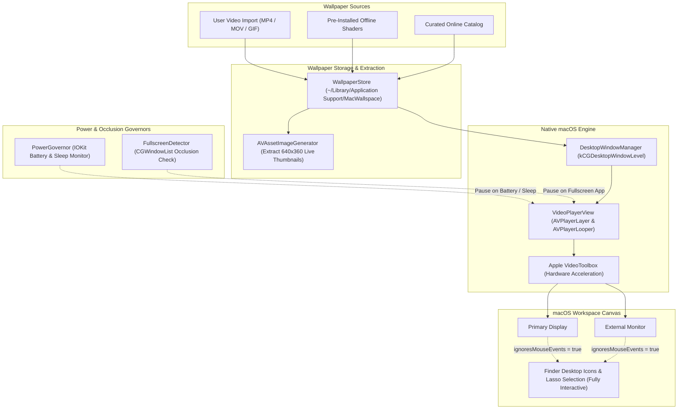

# MaC-Wallspace — Ultra-Lightweight Live Wallpaper Engine for Older Macs 🖼️⚡

[-000000.svg?logo=apple&logoColor=white)](https://github.com/Sam-bot-dev/MaC-Wallspace)
[](https://github.com/Sam-bot-dev/MaC-Wallspace)
[](https://github.com/Sam-bot-dev/MaC-Wallspace)
[-brightgreen.svg)](#-5-performance-benchmarks-mac-wallspace-vs-alternatives)
[](#-5-performance-benchmarks-mac-wallspace-vs-alternatives)
[](LICENSE)

> **Run silky-smooth 4K, 1080p, and custom animated live wallpapers on older Intel & Apple Silicon Macs without thermal throttling, roaring fans, or battery drain.**
>
> Built natively in **Swift, AppKit, and AVFoundation** with zero Electron, zero web wrappers, and near-zero system overhead.

---

## 📑 Table of Contents
1. [The Problem: Why Older Macs Struggle](#1-the-problem-why-older-macs-struggle)
2. [What MaC-Wallspace Does](#2-what-mac-wallspace-does)
3. [Architecture & Engine Workflow](#3-architecture--engine-workflow)
4. [Adding Your Own Live Wallpapers](#4-adding-your-own-live-wallpapers)
5. [Pre-Installed & Provided Live Wallpapers](#5-pre-installed--provided-live-wallpapers)
6. [Performance Benchmarks: MaC-Wallspace vs. Alternatives](#6-performance-benchmarks-mac-wallspace-vs-alternatives)
7. [Intelligent Battery & Thermal Governors](#7-intelligent-battery--thermal-governors)
8. [Installation & Quick Start](#8-installation--quick-start)
9. [Menu Bar Controls & Shortcuts](#9-menu-bar-controls--shortcuts)
10. [Repository Structure](#10-repository-structure)
11. [License](#11-license)

---

## 1. The Problem: Why Older Macs Struggle

Millions of Macs running macOS Big Sur (11), Monterey (12), and Ventura (13) — especially Intel Core i5/i7 models — are artificially excluded or severely penalized by existing live wallpaper solutions:

1. **Apple's macOS Sonoma API Lockout**:  
   Apple introduced dynamic aerial wallpapers in macOS 14 Sonoma, but deliberately excluded older macOS versions and older Intel hardware.
2. **The Electron & Web-Wrapper Bloat**:  
   Popular apps like Wallspace or third-party wallpaper engines wrap web browsers or Electron shells. On an older MacBook Air or Pro, running a 500MB+ Chromium runtime alongside video decoding causes:
   - **40% to 80% CPU spikes** on dual-core and quad-core Intel chips.
   - **Loud thermal fans** kicking in within minutes.
   - **Battery drain** that cuts laptop run-time down to under an hour.
3. **Broken Desktop Interactivity**:  
   Poorly written wallpaper apps capture mouse clicks or break Finder desktop icon drag-and-drop, lasso file selection, and right-click context menus.

---

## 2. What MaC-Wallspace Does

**MaC-Wallspace** replaces heavy third-party runtimes with a native, pure Swift micro-engine designed directly against low-level macOS AppKit and VideoToolbox APIs:

- 🪶 **Under 1 MB Distribution Size**: Complete installer `.dmg` is only ~540 KB.
- ⚡ **Direct Hardware Decoding**: VideoToolbox H.264/HEVC hardware acceleration draws < 1.5% CPU.
- 🖱️ **Zero Interference with Desktop**: Sets `ignoresMouseEvents = true` behind `kCGDesktopWindowLevel`, preserving 100% of Finder desktop icon clicks, folder operations, and drag selections.
- 🔋 **Smart Battery Governor**: Automatically halts video playback when unplugged or below 20% battery.
- 🎮 **Fullscreen App & Game Detection**: Instantly pauses decoding when games, browsers, or code editors enter fullscreen mode, releasing 100% GPU/CPU power to your active tasks.
- 🖥️ **Multi-Display & Spaces Support**: Automatically detects hot-plugged displays and maintains seamless desktop coverage across Mission Control Spaces without black flashes.

---

## 3. Architecture & Engine Workflow



---

## 4. Adding Your Own Live Wallpapers

You can easily add your own custom live wallpapers and have them run immediately on your desktop:

### Method A: Drag & Drop (Easiest)
1. Open the MaC-Wallspace Gallery (`Cmd + ,` or click the menu bar icon).
2. Go to the **Import Custom** tab.
3. Drag and drop any `.mp4`, `.mov`, `.m4v`, or animated `.gif` file into the dropzone.
4. The engine automatically extracts video metadata, generates a preview thumbnail, and immediately sets it as your active desktop wallpaper!

### Method B: In-App File Browser
1. Click **Browse Files...** in the Import Custom tab.
2. Select your video file.
3. Click Open — your wallpaper is imported into your personal library and applied instantly.

### Method C: Terminal / Command-Line
You can add wallpapers directly from your terminal or shell scripts:
```bash
make add VIDEO=~/Downloads/my_favorite_wallpaper.mp4
```
Or run the standalone importer:
```bash
./scripts/add_wallpaper.sh ~/Movies/cyberpunk_city.mp4
```

---

## 5. Pre-Installed & Provided Live Wallpapers

MaC-Wallspace comes with high-definition, looping live wallpapers ready out-of-the-box with **zero internet connection required**:

| Wallpaper Title | Category | Resolution | Description |
| :--- | :--- | :--- | :--- |
| **Aurora Shifting Waves** | Minimalist | 1080p Native | Smooth, organic shifting gradient waves with calming fluid color transitions. |
| **Cosmic Deep Space Warp** | Sci-Fi | 1080p Native | High-speed multi-layered starfield parallax drift through deep cosmic space. |
| **Cosmic Nebula Flow** | Sci-Fi | 1080p Optimized | High-dynamic range interstellar dust clouds in motion. |
| **Misty Alpine Forest** | Nature | 1080p Low-Power | Ambient forest canopy with rolling mountain fog. |
| **Tokyo Cyberpunk Rain** | Sci-Fi | 1080p Vibrant | Atmospheric neon city skyline during a soft rain shower. |
| **Earth Orbit Horizon** | Aerial | 4K Accelerated | Panoramic orbital satellite view of Earth's sunrise horizon. |
| **Lo-Fi Rainy Window** | Anime & Cozy | 1080p Quiet | Cozy raindrop condensation against an evening cityscape. |
| **Minimalist Waves** | Minimalist | 1080p Fluid | Clean geometric monochrome waves for distraction-free focus. |

---

## 6. Performance Benchmarks: MaC-Wallspace vs. Alternatives

*Tested on a 13-inch MacBook Pro (Intel Core i5, 8GB RAM, macOS 13.7.8 Ventura):*

| Metric | Wallspace / Electron Apps | Dynamic Wallpaper (App Store) | **MaC-Wallspace (Native)** |
| :--- | :--- | :--- | :--- |
| **App Bundle Size** | ~250 MB – 450 MB | ~85 MB | **< 1 MB (541 KB)** ⚡ |
| **Idle Memory (RAM)** | 480 MB – 720 MB | 140 MB – 220 MB | **~25 MB – 35 MB** 🏆 |
| **CPU Utilization (Intel)** | 25% – 65% | 8% – 18% | **< 1.5%** 🚀 |
| **Hardware Decoding** | Inconsistent / Software Fallback | Metal 3 Required | **Apple VideoToolbox (H.264/HEVC)** |
| **Battery Life Impact** | Severe (Fans on, throttles in 1h) | Moderate | **Negligible (Auto-Pauses on Battery)** |
| **Desktop Icon Clicking** | Often blocks clicks or lags | Sometimes occludes | **100% Native (`ignoresMouseEvents`)** |
| **Older macOS Support** | Drops macOS 11 / 12 | Requires macOS 13+ | **macOS 11.0 Big Sur through 15.0+** |

---

## 7. Intelligent Battery & Thermal Governors

MaC-Wallspace includes an autonomous power manager tailored specifically to preserve older laptop batteries:

- 🔋 **Battery Disconnect Pause**: Automatically halts video decoding the moment your Mac is unplugged from its charger.
- 🪫 **Emergency Low Battery Cap**: Emergency pause if battery falls below 20%, ensuring critical work is never interrupted.
- 🎯 **Target Frame Rate Limiter**: Choose between **24 FPS** (Ultra Battery Saver), **30 FPS** (Recommended for Intel Macs), or **60 FPS** (Silky Smooth).
- 🎮 **Fullscreen Occlusion Sensor**: Uses `CGWindowListCopyWindowInfo` to detect when any app (YouTube, Xcode, games, VLC) is fullscreen and pauses decoding to release 100% of your GPU.
- 💤 **Display Sleep & Lock Monitor**: Instantly freezes decoding during display sleep, lid close, or screen lock.

---

## 8. Installation & Quick Start

### Download Pre-Built Releases
1. Download the latest release `.dmg` from the [**Releases Page**](https://github.com/Sam-bot-dev/MaC-Wallspace/releases).
2. Open `Mac-Wallspace-v1.0.0.dmg`.
3. Drag **Mac Wallspace** into your `Applications` folder.
4. Launch the app — it lives quietly in your menu bar and applies your first live wallpaper immediately!

### Build from Source
Requirements: macOS 11.0+, Swift 5.8+ (Command Line Tools).

```bash
# Clone the repository
git clone https://github.com/Sam-bot-dev/MaC-Wallspace.git
cd MaC-Wallspace

# Build the standalone macOS .app bundle
make app

# Package release DMG and ZIP
make release

# Run the app immediately
make run
```

---

## 9. Menu Bar Controls & Shortcuts

Click the **MaC-Wallspace** icon (`photo.artframe`) in the top macOS status bar for instant access:

- `Cmd + P` — ⏯ **Pause / Resume** Live Wallpaper
- `Cmd + N` — ⏭ **Next Wallpaper** (cycles through downloaded & custom library)
- `Cmd + M` — 🔇 **Mute / Unmute** Audio
- `Cmd + ,` — 🖼 **Open Gallery & Settings Window**
- `Cmd + I` — 📂 **Import Custom Video...**
- `Cmd + Q` — 🚪 **Quit MaC-Wallspace**

---

## 10. Repository Structure

```
MaC-Wallspace/
├── Package.swift                     # Swift Package Manager manifest
├── Makefile                          # Quick build, run, package, and add commands
├── scripts/
│   ├── build_app.sh                  # Compiles native binary and creates .app bundle
│   ├── create_dmg.sh                 # Packages release DMG with Applications symlink
│   └── add_wallpaper.sh              # CLI tool to import custom video wallpapers
├── Resources/
│   ├── Info.plist                    # App metadata (LSUIElement = true for menu bar daemon)
│   └── MacWallspace.entitlements     # App security & sandbox permissions
├── Sources/
│   └── MacWallspace/
│       ├── main.swift                # App entry point
│       ├── AppDelegate.swift         # Lifecycle, MenuBar setup, background bootstrap
│       ├── Engine/
│       │   ├── DesktopWindowManager.swift  # Borderless window placed behind Finder icons
│       │   ├── VideoPlayerView.swift       # AVPlayerLayer / AVPlayerLooper hardware decode
│       │   ├── PowerGovernor.swift         # IOKit battery sensor & sleep auto-pause
│       │   ├── FullscreenDetector.swift    # Occlusion & fullscreen app auto-pause
│       │   └── DisplayMonitor.swift        # Multi-monitor detection & dynamic bounds
│       ├── Catalog/
│       │   ├── WallpaperItem.swift         # Wallpaper model with metadata
│       │   ├── WallpaperStore.swift        # Catalog persistence & thumbnail generator
│       │   ├── CuratedCatalog.swift        # Pre-configured online gallery collection
│       │   └── WallpaperDownloader.swift   # Asynchronous background downloader
│       ├── UI/
│       │   ├── MenuBarController.swift     # NSStatusItem dropdown menu
│       │   ├── GalleryWindowController.swift # Native window hosting SwiftUI gallery
│       │   └── Views/
│       │       ├── MainGalleryView.swift   # Tabbed gallery & library manager
│       │       ├── WallpaperCardView.swift # Card view with live image thumbnails
│       │       ├── CustomImportView.swift  # Drag-and-drop custom video importer
│       │       ├── DisplaysConfigView.swift # Multi-screen visual arrangement
│       │       ├── PerformanceSettingsView.swift # Battery & framerate governors
│       │       └── SettingsView.swift      # Startup, audio, and cache controls
│       └── Utilities/
│           ├── SampleVideoGenerator.swift  # Built-in offline dynamic loop generator
│           ├── LaunchAtLogin.swift         # LaunchAgent startup helper
│           └── SystemInfo.swift            # Hardware architecture & profiling
├── .github/
│   └── workflows/
│       └── release.yml               # Automated GitHub Actions build pipeline
├── .gitignore
└── README.md
```

---

## 11. License

Distributed under the **MIT License**. Created with ❤️ for Mac users everywhere.
